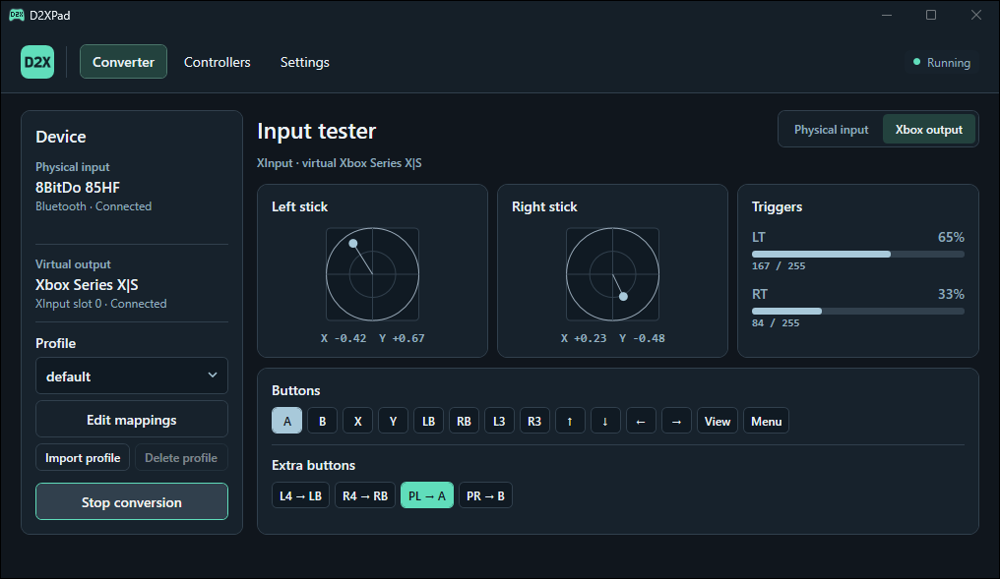

# D2XPad

**DirectInput to XInput Converter**

D2XPad turns a compatible Windows gamepad into a virtual Xbox Series X|S controller. It reads independent analog trigger travel from raw HID reports in Bluetooth DirectInput mode, including on setups where other remappers only see on/off trigger buttons.

The **8BitDo Ultimate 3C+ Wireless** is the only fully tested controller so far. Independent analog triggers, extra-button remapping and grip-motor vibration are verified over Bluetooth. More controllers will be tested.

[Download for Windows](https://github.com/auwaho/D2XPad/releases) · [User guide](docs/usage.md) · [Architecture](docs/architecture.md) · [MIT License](LICENSE)
