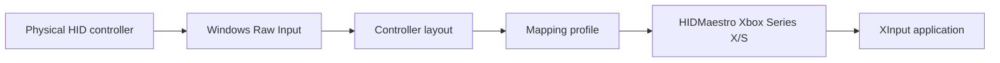

# D2XPad architecture

D2XPad reads one selected physical controller and presents one virtual Xbox Series X|S controller to Windows. It uses Windows Raw Input to read HID gamepad reports, including analog data that may be unavailable through the physical device's DirectInput mapping.

## Input and mappings

- A **controller layout** decodes a particular HID report format into physical button, axis and trigger states. The built-in Bluetooth 85HF layout reads two independent analog trigger fields and four independent extras.
- The calibration wizard learns layouts from a physical USB or Bluetooth gamepad or joystick with one input report ID. Its signature includes VID/PID, transport, usage, report framing and a fingerprint of the HID fields. This matches a saved layout to its report format. The running session also tracks the selected physical instance by interface path and PnP container ID.
- A **profile** belongs to one layout and stores mappings from physical inputs to Xbox actions. One input can contribute to several outputs. Analog actions scale with physical travel and configured strength. Multiple contributions to the same output use the strongest value, and opposing stick directions subtract.
- The WPF desktop can show the decoded physical input before mapping and independently read the resulting virtual controller through XInput.

## Virtual output and session lifecycle

The standard-user converter maintains physical Raw Input and controller state. An elevated HIDMaestro host installs the bundled driver when needed and owns the virtual device. It uses the `xbox-series-xs-bt` profile with independent triggers. A short trigger sequence confirms which XInput slot follows the virtual controller before forwarding physical input. [HIDMaestro 2.2.0 SDK](https://github.com/hifihedgehog/HIDMaestro/releases/tag/v2.2.0)

A compatible profile switch resets Xbox output to neutral on the existing slot. Disconnect and Windows suspend also neutralize output. Once the same physical device is available and its inputs return to rest, the session can resume on the existing virtual controller. Stopping conversion releases that controller.

## Vibration

The HIDMaestro host forwards supported left and right motor effects through a separate feedback channel. A physical output worker converts those effects to the verified Bluetooth 85HF HID report. The worker clears the active effect when vibration is disabled, the controller detaches, Windows suspends or conversion stops. Trigger motors and other physical transports need their own supported feedback route.

## Storage

The Bluetooth 85HF layout and its presets ship with the app. Saved profiles live in `profiles\` beside the executable. Layouts and desktop preferences live under `%LOCALAPPDATA%\D2XPad\`. Separating these records keeps physical report offsets and calibration tied to the controller and lets several profiles share one layout. [Usage and backup locations](usage.md#back-up-profiles-and-layouts)

## Build from source

On Windows x64 with the .NET 10 SDK, run `.\scripts\Build-Desktop.ps1` in PowerShell from the repository root. The build verifies the bundled HIDMaestro dependency and publishes the desktop package to `artifacts/Desktop`. [.NET 10 SDK](https://dotnet.microsoft.com/en-us/download/dotnet/10.0)

## Acknowledgment

UR-XD provided an early reference for understanding the Bluetooth 85HF's raw reports. D2XPad's built-in layout was verified against its own input captures. [UR-XD v2.2](https://github.com/jesga06/UR-XD/releases/tag/v2.2)
