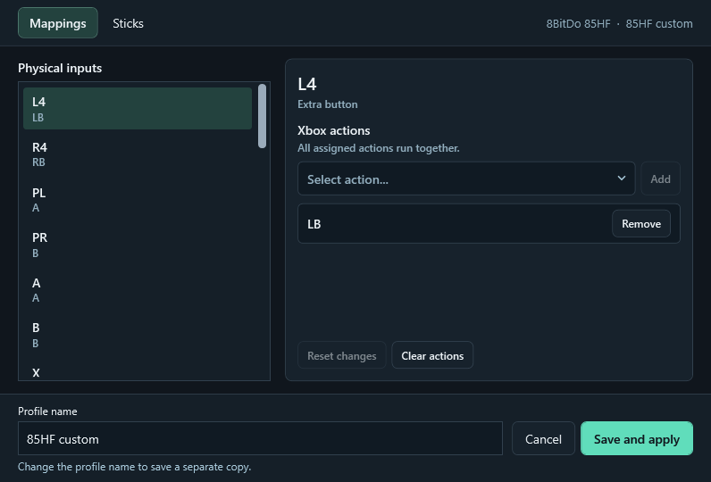
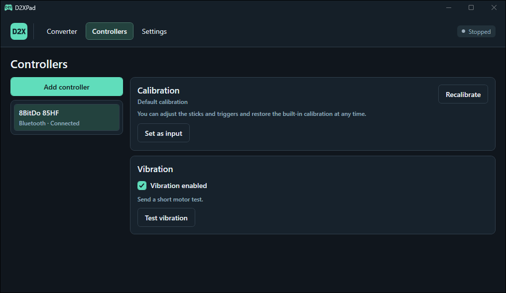

# Using D2XPad

D2XPad runs on Windows x64 and requires the .NET 10 Desktop Runtime. Extract the complete ZIP to a folder you can write to and open `D2XPad.exe`. Windows may ask for permission to start the HIDMaestro driver host when you start conversion. [Download the .NET 10 Desktop Runtime](https://dotnet.microsoft.com/en-us/download/dotnet/10.0)

## Start conversion

1. Connect your controller over USB or pair it in Windows Bluetooth settings. On **Converter**, the **Device** card shows the selected physical input. For a controller without a saved or built-in layout, complete **Controllers → Add controller** first.
2. Choose a profile and select **Start conversion**. In the input tester, use **Physical input** to check the controls before mapping and **Xbox output** to check the virtual Xbox Series X|S. Press and release a button or move a stick to get the first physical reading.
3. In the game, use the virtual Xbox controller. If the game sees both devices or responds twice, select the virtual controller in the game and check for another remapper acting on the physical controller.

You can switch compatible profiles while conversion is running. Release held controls after the switch. If the controller disconnects, leave conversion running and reconnect the same device. Release the controls to resume input on the existing virtual controller.

The input tester keeps its selected source when you switch tabs, open calibration or reconnect the controller.

The status bar shows one message at a time and gives errors priority over warnings and confirmations. Confirmations disappear after a few seconds. When an error has technical details, use **Copy details** to copy the full diagnostic or hover over the message to read it.

Closing the window keeps conversion running in the system tray. Click the **D2X** tray icon to reopen it. **Stop conversion** releases the virtual controller, and **Exit D2XPad** in the tray menu closes the app.

In **Settings → App**, **Start with Windows** launches D2XPad when you sign in. **Start minimized in the tray** keeps the main window hidden on startup. Both options are off by default. Start conversion from the **Converter** tab. D2XPad remembers the last selected profile for each controller layout.

If you move the portable app, turn on **Start with Windows** again from the new location to update the startup path.

## Built-in 85HF profiles

A fresh install selects `default` for the Bluetooth 85HF and also includes `southpaw-buttons`. Standard inputs pass through in both profiles.

| Profile | L4 | R4 | PL | PR |
| --- | --- | --- | --- | --- |
| `default` | LB | RB | A | B |
| `southpaw-buttons` | RB | LB | B | A |

## Edit mappings

Choose **Edit mappings**, select a standard input or a named extra button and pick an Xbox action before selecting **Add**. Add several actions to send them together. For example, assign **RT** at 100% and **Left stick up** at 75% to one paddle. **Strength** scales analog outputs.

**Clear actions** disables Xbox output for the selected input. **Undo clear** brings back the actions and strengths from immediately before the clear. **Reset changes** restores the open profile's actions for that input. A customized standard input also offers **Use default** to restore its standard Xbox action.

**Save and apply** updates a saved profile. Enter a new name and choose **Save copy and apply** to create a separate profile from a built-in or saved one. **Import profile** adds a mapping file to the catalog. A profile for another saved controller appears when you select that controller. **Delete profile** removes a saved profile after confirmation and keeps a `.bak` that you can import again. The editor and physical input tester also work with conversion stopped.

## Add another controller

The built-in layout supports the 8BitDo Ultimate 3C+ Wireless in the Bluetooth mode identified by Windows as **85HF** (VID/PID `2DC8:2067`). Other controllers can be candidates for calibration when their USB or Bluetooth mode exposes a physical HID gamepad or joystick collection with one input report format. Unnumbered reports qualify. The 8BitDo Ultimate 2C is unverified and has no built-in layout.

On a fresh install with an Ultimate 2C, **Controllers** lists the built-in **8BitDo 85HF** layout. It shows **Offline** when that controller is absent. The `default` and `southpaw-buttons` presets belong to the 85HF layout. Use **Add controller** to see whether the connected 2C is eligible for calibration. Saving a 2C layout adds a separate `<controller name> · default` profile for that layout. Vibration is currently available only on the Bluetooth 85HF.

1. Connect the controller in the mode you intend to use and open **Controllers → Add controller**.
2. Record two resting samples, then follow the prompts for the standard controls. The wizard steps through sticks, triggers, D-pad and buttons, including Guide. You can continue straight to **Test layout** or add only the extra buttons you want to map. For each independently reported extra you want to add, enter a unique name of up to six uppercase English letters or digits, select **Add button** and follow the prompts.
3. Select **Test layout** and check sticks, D-pad, buttons and both triggers. Select **Save layout** when the measurements look right. With conversion stopped, use **Set as input** in **Controllers** to switch to a connected saved controller.

The wizard can skip a missing control. Calibrated standard controls start with their corresponding Xbox actions. Named extras start unassigned and are available in every profile for that layout. Controls split across collections or report IDs cannot be combined. An extra button that the controller firmware reports as a copy of a standard button shares that button's mapping.

With conversion stopped, use **Recalibrate** to update a saved layout. **Forget controller** archives a learned layout and retains its profiles for **Restore controller**.

## Vibration

The current vibration output targets the verified Bluetooth 85HF. **Controllers → Vibration enabled** forwards the left and right grip motor commands and is enabled by default for that layout. To check the physical motors independently, stop conversion and select **Test vibration**.

## Back up profiles and layouts

| Data | Default location |
| --- | --- |
| Saved mapping profiles and backups | `profiles\` beside `D2XPad.exe` |
| Learned and customized controller layouts | `%LOCALAPPDATA%\D2XPad\layouts\` |
| Desktop settings and remembered selections | `%LOCALAPPDATA%\D2XPad\desktop.json` |

Keep a copy of the `profiles` directory when replacing the app. A profile for a calibrated controller needs its matching layout on the destination installation.

[Architecture](architecture.md)
